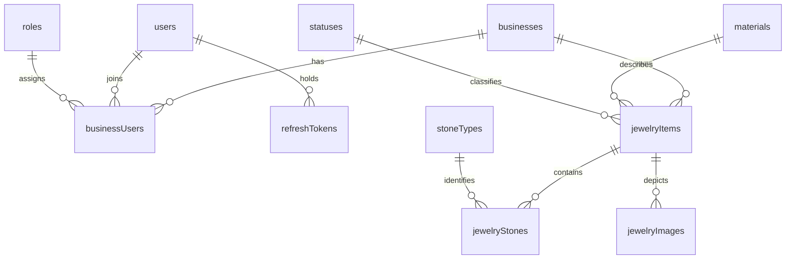

# Jewelry Inventory App: approved database and application flow

## Purpose and source of truth

This app replaces handwritten inventory cards for a jewelry business owner who
is not particularly technical. The first useful experience is a familiar digital
card: search by inventory number or style number, inspect a piece and its photos,
materials, gemstones and financial information, add or edit it, and change its
current status.

The approved [initial migration](../migrations/0001_initial_schema.sql) is the
authority for exact SQL definitions, defaults, constraints, indexes and seeds.
This document records their intended business meaning and how the existing
architecture should support them. It describes the working-tree migration
reviewed on October 25, 2026, including its plural table names. It does not assume
that the migration has been applied to any database.

**Implementation boundary:** the repository currently contains an authentication
starter, public Zod models, OpenAPI generation and a React account demo. Inventory
screens, inventory APIs, business membership authorization and image storage are
planned behavior, not implemented functionality. Auth repositories and regenerated
DTOs now use the approved plural table names, and password login explicitly
rejects NULL passwords. Other [integration gaps](#current-implementation-and-integration-gaps)
remain before the inventory flow can be implemented.

The initial deployment has one explicitly provisioned user, one business and an
owner membership. Multiple businesses and memberships are possible in the schema;
SaaS onboarding and administration are outside the initial scope.

## Relationships

Every child references exactly one parent on each edge; a parent may have zero
children. `businessUsers` connects users and businesses with one role per
membership and a unique `(businessId, userId)` pair. Roles are not global user
assignments. There is no `userRoles` or `businessUserRoles` table.

Each `jewelryItems` row is one individually tracked physical piece, owned by a
business. `inventoryNumber` is unique within that business; `styleNumber` can
repeat across pieces. There is no stock quantity or product variant system, and
no direct user ownership foreign key on an item. Inventory access comes through
business membership. `materials`, `statuses`, `stoneTypes` and `roles` are shared
lookups, not business-owned catalogs.

## Table definitions

There are exactly 11 tables, all using `ENGINE = InnoDB`. Each has an explicitly
named primary-key **column**, not a plain `id` column. The SQL uses `PRIMARY KEY
(columnName)`; it does not assign custom names to primary-key constraints.
All primary keys and foreign-key IDs are `INT UNSIGNED`. Auto-increment examples
below are illustrative, not fixed seed IDs.

In the tables below, `PK; AUTO_INCREMENT` means a required generated primary key;
`required; no default` means the application must supply the value. `NULL` denotes
SQL NULL, not the string `"NULL"`. `description` is declared `TEXT NULL` without
an explicit `DEFAULT` clause; omission leaves it NULL.

Every `inserted` column is `TIMESTAMP NOT NULL DEFAULT CURRENT_TIMESTAMP`.
Every `updated` column is `TIMESTAMP NOT NULL DEFAULT CURRENT_TIMESTAMP ON UPDATE
CURRENT_TIMESTAMP`. These are database audit timestamps, not manufacture dates
or a change-history log. Child changes do not automatically update a parent row's
`updated` timestamp. Audit examples are intentionally blank.

### businesses

| Column | MySQL type | Nullable | Default / behavior | Example |
| --- | --- | --- | --- | --- |
| businessId | INT UNSIGNED | No | PK; AUTO_INCREMENT | 1 |
| name | VARCHAR(255) | No | Required; no default | Jewelry Workshop |
| inserted | TIMESTAMP | No | CURRENT_TIMESTAMP | |
| updated | TIMESTAMP | No | CURRENT_TIMESTAMP; ON UPDATE CURRENT_TIMESTAMP | |

Primary key: `(businessId)`. No other declared indexes or unique constraints;
business names need not be unique.

### users

| Column | MySQL type | Nullable | Default / behavior | Example |
| --- | --- | --- | --- | --- |
| userId | INT UNSIGNED | No | PK; AUTO_INCREMENT | 7 |
| email | VARCHAR(255) | No | Required; unique; no default | owner@example.com |
| password | VARCHAR(512) | Yes | NULL; application password hash when present | Argon2id hash |
| inserted | TIMESTAMP | No | CURRENT_TIMESTAMP | |
| updated | TIMESTAMP | No | CURRENT_TIMESTAMP; ON UPDATE CURRENT_TIMESTAMP | |

Primary key: `(userId)`. `uq_users_email` is unique on `(email)`. This is local
application identity; NULL permits future accounts without a local password.
The database does not validate password hashes or email syntax.

### roles

| Column | MySQL type | Nullable | Default / behavior | Example |
| --- | --- | --- | --- | --- |
| roleId | INT UNSIGNED | No | PK; AUTO_INCREMENT | 2 |
| name | VARCHAR(30) | No | Required; unique; no default | member |
| inserted | TIMESTAMP | No | CURRENT_TIMESTAMP | |
| updated | TIMESTAMP | No | CURRENT_TIMESTAMP; ON UPDATE CURRENT_TIMESTAMP | |

Primary key: `(roleId)`. `uq_roles_name` is unique on `(name)`.
Seed names: `owner`, `member`. Membership references one role; detailed permission
differences are deferred. Do not assume inventory is accessible only to owners.

### businessUsers

| Column | MySQL type | Nullable | Default / behavior | Example |
| --- | --- | --- | --- | --- |
| businessUserId | INT UNSIGNED | No | PK; AUTO_INCREMENT | 10 |
| businessId | INT UNSIGNED | No | Required FK to businesses; no default | 1 |
| userId | INT UNSIGNED | No | Required FK to users; no default | 7 |
| roleId | INT UNSIGNED | No | Required FK to roles; no default | Owner role's resolved ID |
| inserted | TIMESTAMP | No | CURRENT_TIMESTAMP | |
| updated | TIMESTAMP | No | CURRENT_TIMESTAMP; ON UPDATE CURRENT_TIMESTAMP | |

Primary key: `(businessUserId)`.

- `uq_businessUsers_businessId_userId`: unique `(businessId, userId)`.
- `ix_businessUsers_userId`: `(userId)`.
- `ix_businessUsers_roleId`: `(roleId)`.

The composite unique index also supports membership checks starting with
`businessId`. A user can belong to several businesses with different roles.

### refreshTokens

| Column | MySQL type | Nullable | Default / behavior | Example |
| --- | --- | --- | --- | --- |
| refreshTokenId | INT UNSIGNED | No | PK; AUTO_INCREMENT | 100 |
| userId | INT UNSIGNED | No | Required FK to users; no default | 7 |
| tokenHash | VARCHAR(64) | No | Required; unique; no default | SHA-256 hex digest of application refresh token |
| isRevoked | TINYINT | No | 0; CHECK permits only 0 or 1 | 0 |
| expiration | TIMESTAMP | No | Required; no default | 2026-11-01 12:00:00 |
| inserted | TIMESTAMP | No | CURRENT_TIMESTAMP | |
| updated | TIMESTAMP | No | CURRENT_TIMESTAMP; ON UPDATE CURRENT_TIMESTAMP | |

Primary key: `(refreshTokenId)`.

- `uq_refreshTokens_tokenHash`: unique `(tokenHash)`.
- `ix_refreshTokens_userId_isRevoked`: `(userId, isRevoked)`.
- `chk_refreshTokens_isRevoked`: `isRevoked IN (0, 1)`.

A user can have multiple application session records. These are not Google
provider tokens. `isRevoked` is a signed `TINYINT` constrained to 0/1, not an
unsigned identifier or a driver-level boolean. Hash encoding is application
behavior; the schema only enforces its maximum length and uniqueness.

### materials

| Column | MySQL type | Nullable | Default / behavior | Example |
| --- | --- | --- | --- | --- |
| materialId | INT UNSIGNED | No | PK; AUTO_INCREMENT | Gold's resolved ID |
| name | VARCHAR(100) | No | Required; unique; no default | Gold |
| inserted | TIMESTAMP | No | CURRENT_TIMESTAMP | |
| updated | TIMESTAMP | No | CURRENT_TIMESTAMP; ON UPDATE CURRENT_TIMESTAMP | |

Primary key: `(materialId)`. `uq_materials_name` is unique on `(name)`.
Seed names: `Gold`, `Silver`, `Bronze`. This table identifies the main material;
it contains no shared market price. Each item stores its own cost and code.

### statuses

| Column | MySQL type | Nullable | Default / behavior | Example |
| --- | --- | --- | --- | --- |
| statusId | INT UNSIGNED | No | PK; AUTO_INCREMENT | Unknown status's resolved ID |
| name | VARCHAR(30) | No | Required; unique; no default | unknown |
| inserted | TIMESTAMP | No | CURRENT_TIMESTAMP | |
| updated | TIMESTAMP | No | CURRENT_TIMESTAMP; ON UPDATE CURRENT_TIMESTAMP | |

Primary key: `(statusId)`. `uq_statuses_name` is unique on `(name)`.
Seed names: `unknown`, `available`, `sold`; these labels remain provisional
pending client feedback. An item always references one current status. The
application must explicitly assign `statusId`, resolving actual lookup IDs;
there is no default status ID or status-history table.

### stoneTypes

| Column | MySQL type | Nullable | Default / behavior | Example |
| --- | --- | --- | --- | --- |
| stoneTypeId | INT UNSIGNED | No | PK; AUTO_INCREMENT | Emerald's resolved ID |
| name | VARCHAR(100) | No | Required; unique; no default | Emerald |
| inserted | TIMESTAMP | No | CURRENT_TIMESTAMP | |
| updated | TIMESTAMP | No | CURRENT_TIMESTAMP; ON UPDATE CURRENT_TIMESTAMP | |

Primary key: `(stoneTypeId)`. `uq_stoneTypes_name` is unique on `(name)`.
Seed names: `Diamond`, `Emerald`, `Ruby`, `Sapphire`. Prices and weights belong
to gemstone groups, not this lookup.

### jewelryItems

| Column | MySQL type | Nullable | Default / behavior | Example |
| --- | --- | --- | --- | --- |
| jewelryItemId | INT UNSIGNED | No | PK; AUTO_INCREMENT | 42 |
| businessId | INT UNSIGNED | No | Required FK to businesses; no default | 1 |
| inventoryNumber | VARCHAR(100) | No | Required; unique within business; no default | D2439 |
| styleNumber | VARCHAR(100) | No | Required; may repeat; no default | IR 891 |
| name | VARCHAR(255) | Yes | NULL | NULL |
| description | TEXT | Yes | Nullable; no explicit DEFAULT clause | NULL |
| materialId | INT UNSIGNED | No | Required FK to materials; no default | Gold's resolved ID |
| materialCost | DECIMAL(12,2) | Yes | NULL; nonnegative when known | 670.00 |
| materialCostCode | VARCHAR(50) | Yes | NULL | ROD |
| manufactureYear | SMALLINT UNSIGNED | Yes | NULL; 1–9999 when known | 2026 |
| manufactureMonth | TINYINT UNSIGNED | Yes | NULL; 1–12; requires year | 4 |
| recordedProductionCost | DECIMAL(12,2) | Yes | NULL; nonnegative when known | 1240.00 |
| productionCostCode | VARCHAR(50) | Yes | NULL | SIBD |
| sellingPrice | DECIMAL(12,2) | Yes | NULL; nonnegative when known | 2450.00 |
| insuranceValue | DECIMAL(12,2) | Yes | NULL; nonnegative when known | 1715.00 |
| statusId | INT UNSIGNED | No | Required FK to statuses; no default | Unknown status's resolved ID |
| inserted | TIMESTAMP | No | CURRENT_TIMESTAMP | |
| updated | TIMESTAMP | No | CURRENT_TIMESTAMP; ON UPDATE CURRENT_TIMESTAMP | |

Primary key: `(jewelryItemId)`.

- `uq_jewelryItems_businessId_inventoryNumber`: unique `(businessId, inventoryNumber)`.
- `ix_jewelryItems_businessId_styleNumber`: `(businessId, styleNumber)`.
- `ix_jewelryItems_materialId`: `(materialId)`.
- `ix_jewelryItems_statusId`: `(statusId)`.

Named CHECK constraints:

| Constraint | Allowed values |
| --- | --- |
| chk_jewelryItems_materialCost | NULL or materialCost >= 0 |
| chk_jewelryItems_recordedProductionCost | NULL or recordedProductionCost >= 0 |
| chk_jewelryItems_sellingPrice | NULL or sellingPrice >= 0 |
| chk_jewelryItems_insuranceValue | NULL or insuranceValue >= 0 |
| chk_jewelryItems_manufactureYear | NULL or manufactureYear BETWEEN 1 AND 9999 |
| chk_jewelryItems_manufactureMonth | NULL or manufactureMonth BETWEEN 1 AND 12 |
| chk_jewelryItems_manufactureMonth_requiresYear | manufactureMonth IS NULL OR manufactureYear IS NOT NULL |

The schema requires both inventory and style numbers, even though style numbers
need not be unique. It does not impose nonblank-string validation. No currency
column or currency-conversion behavior is defined.

### jewelryStones

| Column | MySQL type | Nullable | Default / behavior | Example |
| --- | --- | --- | --- | --- |
| jewelryStoneId | INT UNSIGNED | No | PK; AUTO_INCREMENT | 81 |
| jewelryItemId | INT UNSIGNED | No | Required FK to jewelryItems; no default | 42 |
| stoneTypeId | INT UNSIGNED | No | Required FK to stoneTypes; no default | Emerald's resolved ID |
| quantity | INT UNSIGNED | Yes | NULL; positive when known | 3 |
| totalCarats | DECIMAL(10,3) | Yes | NULL; positive when known | 0.680 |
| costPerCarat | DECIMAL(12,2) | Yes | NULL; nonnegative when known | 450.00 |
| costCode | VARCHAR(50) | Yes | NULL | NULL |
| sellingPricePerCarat | DECIMAL(12,2) | Yes | NULL; nonnegative when known | 650.00 |
| sellingPriceCode | VARCHAR(50) | Yes | NULL | NULL |
| inserted | TIMESTAMP | No | CURRENT_TIMESTAMP | |
| updated | TIMESTAMP | No | CURRENT_TIMESTAMP; ON UPDATE CURRENT_TIMESTAMP | |

Primary key: `(jewelryStoneId)`.

- `ix_jewelryStones_jewelryItemId`: `(jewelryItemId)`.
- `ix_jewelryStones_stoneTypeId`: `(stoneTypeId)`.
- `chk_jewelryStones_quantity`: NULL or `quantity > 0`.
- `chk_jewelryStones_totalCarats`: NULL or `totalCarats > 0`.
- `chk_jewelryStones_costPerCarat`: NULL or `costPerCarat >= 0`.
- `chk_jewelryStones_sellingPricePerCarat`: NULL or `sellingPricePerCarat >= 0`.

There is no unique `(jewelryItemId, stoneTypeId)` constraint: multiple groups of
the same stone type on the same piece are allowed. There is no `businessId`
column; authorize through the parent item.

### jewelryImages

| Column | MySQL type | Nullable | Default / behavior | Example |
| --- | --- | --- | --- | --- |
| jewelryImageId | INT UNSIGNED | No | PK; AUTO_INCREMENT | 91 |
| jewelryItemId | INT UNSIGNED | No | Required FK to jewelryItems; no default | 42 |
| storageKey | VARCHAR(512) | No | Required object key; no default | jewelry/42/card-front.jpg |
| sortOrder | INT UNSIGNED | No | 0 | 0 |
| inserted | TIMESTAMP | No | CURRENT_TIMESTAMP | |
| updated | TIMESTAMP | No | CURRENT_TIMESTAMP; ON UPDATE CURRENT_TIMESTAMP | |

Primary key: `(jewelryImageId)`.
`ix_jewelryImages_jewelryItemId_sortOrder` indexes `(jewelryItemId, sortOrder)`.
Neither `storageKey` nor `(jewelryItemId, sortOrder)` is unique. Display order is
`sortOrder ASC, jewelryImageId ASC`; the first image is the cover. There is no
`isPrimary` column and no duplicated `businessId`.

### Foreign keys and deletion behavior

All foreign keys use `ON UPDATE RESTRICT`. All use `ON DELETE RESTRICT` except
`fk_refreshTokens_user`, which uses `ON DELETE CASCADE`.

| Foreign-key constraint | Child column | Parent column | ON DELETE |
| --- | --- | --- | --- |
| fk_businessUsers_business | businessUsers.businessId | businesses.businessId | RESTRICT |
| fk_businessUsers_user | businessUsers.userId | users.userId | RESTRICT |
| fk_businessUsers_role | businessUsers.roleId | roles.roleId | RESTRICT |
| fk_refreshTokens_user | refreshTokens.userId | users.userId | CASCADE |
| fk_jewelryItems_business | jewelryItems.businessId | businesses.businessId | RESTRICT |
| fk_jewelryItems_material | jewelryItems.materialId | materials.materialId | RESTRICT |
| fk_jewelryItems_status | jewelryItems.statusId | statuses.statusId | RESTRICT |
| fk_jewelryStones_jewelryItem | jewelryStones.jewelryItemId | jewelryItems.jewelryItemId | RESTRICT |
| fk_jewelryStones_stoneType | jewelryStones.stoneTypeId | stoneTypes.stoneTypeId | RESTRICT |
| fk_jewelryImages_jewelryItem | jewelryImages.jewelryItemId | jewelryItems.jewelryItemId | RESTRICT |

Deleting a business with memberships or inventory, a referenced lookup, or an
item with stones/images is blocked. Deleting a user with memberships is blocked;
if a user can be deleted, their refresh-token records cascade. Images and stone
groups never cascade from an item. Retain sold items; a general item-deletion
workflow is not part of the initial card flow. Database restrictions do not
remove stored image objects.

The indexes listed above are exactly the declared primary, unique and secondary
indexes. The migration does not specify a character set or collation; equality,
uniqueness and case behavior for text depend on database configuration. Do not
promise case-sensitive inventory numbers or email matching without deciding
that policy.

Enforced CHECK constraints require **MySQL 8.0.16 or later**. Older versions
parsed and ignored the limited CHECK syntax, so they cannot provide the intended
validation. See the [MySQL CHECK constraint reference](https://dev.mysql.com/doc/refman/8.0/en/create-table-check-constraints.html).
The repository does not currently pin or verify a server version.

## Inventory-card domain rules

### Material, gemstone groups and financial values

An item has exactly one main material, such as Gold. `materialCost` is a manually
recorded amount for that piece, and `materialCostCode` is its proprietary code.
It can be edited, but market price changes never automatically reprice it. There
is no `jewelryMaterials` join table because independently tracked multiple
materials per piece are not required.

Each gemstone row describes a **group** within a piece. `quantity` counts stones;
`totalCarats` is the combined weight of that group. Purchase and selling rates
are per carat because that matches the client's workflow. Do not infer individual
stone weights or assume equal weights. Unknown group quantities, weights, rates
and codes remain NULL. Known quantities and carat weights must be positive;
known rates may be zero.

Keep these values separate: main material cost, gemstone purchase rates, gemstone
selling rates, recorded total production cost, final retail selling price,
insurance value, and each associated proprietary code. `recordedProductionCost`
is manually entered, not automatically derived from components. `insuranceValue`
is independently entered, not a fixed percentage of retail. Calculations may
explain known components but must never overwrite recorded amounts.

Financial NULL means unknown; zero means an explicitly recorded zero. Missing
form values must not silently become zero. Codes are ordinary text, may repeat,
and have no uniqueness constraint, `priceCodes` lookup or decoder. No general
cost-components table, accounting engine, automatic repricing or pricing-history
system is included.

### Manufacture precision and current status

Store only the precision supplied by a card: year alone is valid, month requires
year, and both may be NULL. Never invent a day, time or full manufacture date.
`inserted` and `updated` are unrelated to manufacture precision.

Assign the resolved `unknown` status when the card's status is unconfirmed; do
not leave the required foreign key NULL. The client has not yet confirmed the
exact process for distinguishing sold stock. Retain sold records, showing their
current status; there is no status history or separate archival system.

### Worked card: D2439 / IR 891

These are illustrative records, not inserts or fixtures. Numeric IDs are not seed
contracts. Resolve lookup IDs by their actual rows.

The item `D2439` in the provisioned business has style `IR 891`, material Gold
through `materialId`, and the following recorded fields:

| Item field | Recorded value |
| --- | --- |
| materialCost / materialCostCode | 670.00 / ROD |
| manufactureYear / manufactureMonth | 2026 / 4 |
| recordedProductionCost / productionCostCode | 1240.00 / SIBD |
| sellingPrice | 2450.00 |
| insuranceValue | 1715.00 |
| statusId | Resolved unknown status; actual status awaiting confirmation |

Two `jewelryStones` rows reference the same `jewelryItemId`:

| Group (via stoneTypeId) | quantity | totalCarats | costPerCarat | costCode | sellingPricePerCarat | sellingPriceCode |
| --- | --- | --- | --- | --- | --- | --- |
| Emerald | 3 | 0.680 | 450.00 | NULL | 650.00 | NULL |
| Diamond | 16 | 0.500 | 430.00 | NULL | 630.00 | RLD |

The known purchase component subtotal is:

`670 + (0.680 × 450) + (0.500 × 430) = 1191`.

The recorded production cost remains `1240.00`. The `49.00` difference is
unexplained; do not invent a labor charge or adjustment. Neither gemstone selling
rate determines the recorded retail selling price. The insurance entry remains
independent even though these example numbers have a numerical relationship.

The photograph belongs in a separate `jewelryImages` row referencing this item's
ID, with its object key and sort order. It is not embedded in the item or a stone
group. If the example item ID is 42, both groups and the photo reference 42, not
the inventory number or a user ID.

## Intended application and authorization flow

Reuse [the backend resource pattern](backend-resource-pattern.md),
[the architecture walkthrough](data-flow-and-findep-comparison.md),
[the public Zod/OpenAPI boundary](openapi-zod-contract.md) and
[the type-safety policy](type-safety.md). The following describes future
inventory use cases; it does not add routes or require CRUD APIs for every table.

Request path:

`React → feature hook → generated SDK / TanStack helpers → route → authentication
and authorization middleware → controller (Zod validation) → service (rules and
transaction coordination) → repository (parameterized SQL) → MySQL`.

Response path:

`database DTO / query projection → explicit mapper and public response model →
controller response → generated SDK → TanStack Query cache → UI`.

DTOs remain internal. Public schemas should describe the useful card response,
not expose every storage column. Controllers validate body, query and route input;
services coordinate authorized use cases; repositories own SQL. Lookup tables
can support read-only selection without independent administration APIs.

### Authentication and business access

Preserve the useful existing Argon2id, JWT and hashed application-refresh-token
approach described in [the current auth flow](current-auth-flow.md), while
addressing its schema mismatches below. Password accounts require a real hash;
password login must always fail if `users.password` is NULL. A dummy verification
may preserve generic failure timing, but must never make a passwordless account
eligible to authenticate.

Public registration is unnecessary for the initial deployment. Explicitly
provision the first user, business and `businessUsers` owner membership; the
approved migration seeds lookups only. No bootstrap implementation is supplied
here. The existing registration endpoint/UI does not provision a business or
membership and should not be the deployed onboarding flow.

For every deployed inventory request:

1. Authenticate the local user from the verified access token, not submitted IDs.
2. Resolve or validate the relevant business and verify its `businessUsers` row
   for that user. A submitted `businessId` is input, not proof of access, even in
   a one-business deployment. Membership grants the inventory access boundary;
   do not invent owner-only access rules.
3. Scope item reads/writes to the authorized business. An item ID alone never
   grants access. The service/repository must preserve that scope after middleware
   runs; an unscoped repository lookup must not bypass it.
4. Scope gemstone and image access through their parent `jewelryItems` row and
   business. Validate that any submitted child ID belongs to that parent, including
   in batch updates/reorders. Do not duplicate `businessId` onto child tables.
5. Authorize image upload, retrieval, reorder and removal by the same parent
   chain before granting storage access.

Authentication may be omitted only in a local demo context. An unauthenticated
deployed inventory app is outside the approved behavior.

Google OAuth is deferred. A future `authIdentities` table could map a provider
identity to `users.userId`; do not add it now. Google would identify the local
user, while existing memberships would still authorize inventory. Application
refresh tokens remain distinct from Google provider tokens.

### Inventory use cases

| Use case | Intended behavior through the layers |
| --- | --- |
| List/search | Feature hook sends validated inventory/style search and pagination inputs. Membership is checked, then repository queries filter by authorized business and inventory/style number. Use the business-prefixed indexes for appropriate search predicates. Return a public list projection with material/status and optional cover image, plus agreed pagination metadata. |
| Item detail | Query the authorized item with its material and current status; load its stone groups with stone types and its ordered images separately. Map the assembled card into a public response with explicit nullable financial values. |
| Create with gemstones | Controller validates item and group inputs. Service resolves/validates material, status and stone types, uses the authorized business, and inserts the item plus groups on one transaction connection. Roll back all writes if any group fails. Preserve unknown values and allow repeated stone types. Translate duplicate business/inventory number conflicts into an API error. |
| Edit item and related records | Validate all submitted fields and verify every existing child belongs to the authorized item. Apply the agreed child add/update/remove semantics and parent edits in one transaction. Preserve fields omitted by that contract; distinguish omission from explicit NULL. Never recompute recorded financial entries. |
| Change status | Validate the selected existing status and update only the authorized item's current status reference. Explicitly select its ID; do not assume seed order. Keep sold records and invalidate affected list/detail data. No status-history write is implied. |
| Add photographs | Authorize parent, validate upload metadata/content, store an object under an application-controlled key and record the image row. Return an authorized display mechanism separately from the persisted key. Handle storage/DB partial failure as described below. |
| Reorder photographs | Validate child IDs against the parent; update affected sort orders atomically on one DB transaction connection. Read back using sortOrder then jewelryImageId; duplicate sort orders are permitted by SQL. |
| Remove photograph | Authorize the parent and child, remove the image association and arrange object deletion with retry/cleanup if storage deletion fails. Invalidate detail and list cover data; the next ordered image becomes cover. |

Avoid a flat join of both one-to-many collections: two stone groups and three
images produce six rows, which can duplicate arrays and inflate totals. Join
one-to-one material/status data to the item, then load groups and images in
separate scoped queries (batch these for lists), or use independently aggregated
collections with validated projections. Cover selection must follow the defined
two-column order. Child queries still need the authorized parent scope.

Search matching (exact/prefix/substring), pagination/sort contract and edit
payload semantics are not implemented. Decide them before defining public
schemas; arbitrary substring search is not guaranteed efficient by these indexes.

### Transaction and storage boundaries

Atomic multi-write operations must acquire **one** connection from the existing
mysql2 pool, begin a transaction, pass that connection through all participating
repositories, commit on success, roll back on failure, and release in a final
cleanup path. Separate calls to the current pool helpers are not a transaction.
The exported `getConnection()` returns a connection after UTC session setup; the
raw pool is private. The default export exposes `getConnection()` and `end()`.
Repository helpers currently do not accept a transaction connection. Add that capability in future
implementation before relying on item/group or multi-image atomicity.

Private S3-compatible object storage is intended for deployment; local files or
sample images are acceptable for a local demo. Persist only `storageKey`, not
binaries, permanent public URLs or expiring signed URLs. Authorize through the
parent before serving/proxying a private image or issuing a short-lived URL.

Object storage and MySQL cannot share one MySQL transaction. Keep failure handling
small and explicit: if upload succeeds but row creation fails, attempt object
cleanup and retain enough information to retry removal of the orphan. If a row
is removed but object deletion fails, retry object cleanup without restoring a
broken association. A failed upload must not leave a committed image row that
claims success. Decide a simple retry/orphan-cleanup procedure and object-key
ownership policy before deployment; the schema supplies neither. No elaborate
upload framework is required.

### Runtime values and public serialization

The [database configuration](../src/config/db.ts) sets `dateStrings: true` and
does not enable `decimalNumbers`. The DTO generator therefore maps `DECIMAL` to
`string`, date/time columns to `string`, integer types to `number` and nullable
columns to a union with `null`. Its interfaces and mysql2 query generics describe
expected results; they do not validate runtime rows or enforce numeric ranges.

Validate selected database values/projections at runtime before using them in
rules or mapping responses: required IDs and their unsigned range, decimal
syntax/range/scale, nullability, lookup fields, revoked flags and timestamp
format/validity. Use explicit mappers and public Zod schemas, following
`toUserModel` without returning whole DTOs. A generated TypeScript SDK alone
does not establish runtime response validation.

For future financial API contracts, serialize decimals explicitly as exact
decimal strings or NULL: two fractional digits for amounts/rates and three for
carat totals. Validate input scale and range instead of silently rounding or
coercing through JavaScript `Number`/`parseFloat`. If component calculations are
shown, use exact decimal arithmetic and an explicit rounding/display policy.
Do not substitute calculated values for manually recorded fields. Neither exact
decimal calculation tooling nor inventory public schemas exist yet.

All ID columns are unsigned 32-bit integers, representable exactly by JavaScript
numbers, with an upper bound of `4294967295`. Reject negative, fractional,
noncanonical and out-of-range IDs. Existing auth checks validate canonical
positive safe integers but do not enforce the unsigned INT upper bound. Avoid
signed 32-bit coercions or contracts capped at `2147483647`. A TypeScript
`number` does not encode signedness; DTO introspection reads `DATA_TYPE`, not
the unsigned qualifier or CHECK rules, so runtime/public validation must supply
those constraints.

`dateStrings: true` avoids automatic Date conversion but does not give timestamp
strings a time-zone offset. The pool uses `timezone: "Z"` for Date parameters,
and the first checkout of each physical connection awaits
`SET SESSION time_zone = '+00:00'`. Successful initialization is tracked by the
underlying connection identity, rather than mysql2's per-checkout promise wrapper;
reused connections skip the SET round trip. New and replacement connections
initialize independently. Failed session setup destroys the connection and
propagates the error before application SQL. Callers must preserve the session
time zone and destroy connections whose sessions they reset or change.
This establishes UTC for timestamps read/written through the app's DB helpers
and exported `getConnection()`, without changing global server settings.

Refresh expiry checks use `parseMysqlUtcTimestamp` to validate second-precision
`YYYY-MM-DD HH:mm:ss` strings and interpret them explicitly as UTC. Invalid
calendar dates and unexpected formats cause a server error before rotation;
expiration equal to the current instant counts as expired. The refresh projection
now uses string only, matching the driver. Fractional-precision columns would
require an explicit parser update. Future public timestamp fields should map to
validated ISO 8601 instants with an offset before local display. Do not blindly
append `Z` to strings from other sources whose zone is unknown. Keep manufacture
year/month as nullable numeric fields.

### Query caching and code generation

Feature hooks should wrap generated TanStack options. Future inventory keys must
include authorized business identity, operation, item identity where applicable,
search/filter/sort and pagination inputs. Include account/session identity in a
handwritten wrapper key or isolate caches across accounts; the generated key
builder currently includes operation/base URL/path/query/body/explicit headers,
not the current bearer-token callback value. Prefer business-aware path/query
contracts so generated helpers naturally distinguish businesses. Never use a
token itself as a cache-key identifier or treat cache keys as authorization.

On account or business changes, cancel in-flight queries and clear or isolate
old data before enabling the new scope. `App.updateSession` already cancels and
clears on session changes; there is no business switching yet. Maintain this
boundary for logout and failed refresh as well. Mutations should invalidate the
affected business's list/search variants and item detail; image changes also
invalidate cover projections, status changes invalidate filtered lists, and
creates invalidate lists. Use the generated key shape or a consistent wrapper
instead of unrelated ad hoc keys. Lookups are globally shared, although their
retrieval can still require authentication.

Existing auth hooks use generated mutation/query helpers, an in-memory access
token callback and credentialed fetch. Refresh is explicit, with no automatic
401 replay; mutation retries are disabled. Preserve these protections for
one-use refresh tokens. Do not retry writes without defining safe semantics.

Commands below are defined by the package scripts and generator source. Auth DTOs
have since been regenerated from the local `users` and `refreshTokens` metadata;
inventory DTO generation and migrations have not been run as part of this work.

| Command (from repository root) | Existing effect |
| --- | --- |
| `npm --prefix server run generate:resource -- jewelryItem --from-db --table jewelryItems --id jewelryItemId --dry-run` | Preview an internal DTO using the configured database's INFORMATION_SCHEMA; no file writes/build. Requires a database with the approved schema already applied. |
| `npm --prefix server run generate:resource -- jewelryItem --from-db --table jewelryItems --id jewelryItemId` | Generate/overwrite only the DTO, then automatically run the server build. Does not create repositories, services, controllers or routes. |
| `npm --prefix server run generate:resource -- jewelryItem --from-db --table jewelryItems --id jewelryItemId --check` | Compare DTO with live table metadata without writing/building; still needs database access. |
| `npm --prefix server run openapi:generate` | Export public schemas and route registrations into server/openapi.json. |
| `npm --prefix client run api:generate` | Generate Hey API types, fetch SDK and TanStack helpers from server/openapi.json. |
| `npm run api:generate` | Run the preceding two API generation steps in order. |
| `npm run api:check` | Check OpenAPI and frontend generated-file drift without rewriting committed artifacts. |
| `npm run check` | Server type/lint/test/build/OpenAPI checks, client SDK freshness check, client build and tests. Client build regenerates the SDK after the drift check. |

Use explicit `--table users` / `--table refreshTokens` when later regenerating
existing singular resource DTO names. The generator defaults table names to the
resource base name; the regenerated auth DTO headers now include explicit plural
table names.
It reads the live database, not SQL migration text, and does not generate
constraints or relationships as runtime validators.

Define public models separately in `src/models`, register routes in
`src/openapi/document.ts`, and give operations stable, unique `operationId`s;
those IDs determine SDK/helper names. Mark required bodies explicitly. Current
operations cover auth/profile only. Do not hand-edit generated DB DTOs,
`server/openapi.json` or `client/src/api/generated/**`; change their source or
configuration and regenerate when implementation work is authorized. See
[the generation walkthrough](codegen-and-findep-comparison.md) for details.

## Current implementation and integration gaps

This records current implementation after auth table/DTO reconciliation, along
with gaps found during the original repository inspection.

| Area / evidence | Current implementation | Required future integration |
| --- | --- | --- |
| Table names: [user repository](../src/repositories/auth.repository.ts), [token repository](../src/repositories/refreshToken.repository.ts) | SQL now targets approved `users` and `refreshTokens`; resource files/classes remain singular. | Table-name mismatch is resolved. Inventory queries and membership checks remain future work. |
| Migration history and [auth guide](current-auth-flow.md#database-tables) | Earlier starter migrations used singular tables and signed INT identifiers. The approved 0001 replaces that schema; its constraints include the old hardening requirements. The auth guide now reflects plural tables and nullable passwords. | A database already initialized with the old migrations needs an explicit upgrade/data-preservation decision; rewriting 0001 does not upgrade it. Do not run historical singular-table ALTER statements against the new tables. No upgrade migration was added or run here. |
| [User DTO](../src/dtos/user.dto.ts), [token DTO](../src/dtos/refreshToken.dto.ts), [auth projection](../src/dtos/projections/user.projection.ts) | DTOs regenerated from local plural tables: password is string or null, audit timestamps are required strings. AuthUserDTO inherits password nullability through Pick. | Type-shape mismatch is resolved. Runtime database validation and unsigned bounds still need explicit handling. |
| [Sign-in service](../src/services/auth.service.ts) | NULL-password accounts use dummy verification and are explicitly rejected regardless of its result. Generic credential failures are retained. | Passwordless-login guard is covered by regression tests. Google authentication remains deferred; password credential inputs still require a password. |
| [Auth claims](../src/utils/authClaims.ts), [public user model](../src/models/user.model.ts) | IDs use positive safe-integer strings or positive integer numbers; neither states the unsigned INT maximum. | Align DB, Zod/OpenAPI ID bounds and tests with unsigned identifiers. Preserve strict canonical parsing; do not reintroduce signed assumptions from historical SQL. |
| [Routes](../src/routes/auth.route.ts), [authorization](../src/middlewares/authorization.middleware.ts) | `/api/users/me` authenticates; the ID route checks that token subject equals route userId. No business membership authorization exists. | Add membership-scoped inventory authorization; user-profile ownership middleware cannot authorize a business or item. |
| [Registration service](../src/services/auth.service.ts), [account UI](../../client/src/App.tsx) | Public registration inserts a user only; UI offers account creation. Migration seeds lookups but no user/business/membership. | Provision the initial owner/business/membership explicitly and omit/restrict public registration in the deployed flow. Decide the provisioning method before implementation. |
| Inventory and lookups | Tables are approved, but no inventory DTOs, repositories, routes, public contracts, hooks or card UI exist. | Implement card use cases in the existing layers, with scoped queries, validation and explicit mapping. A table does not imply a CRUD endpoint. |
| [DB helpers](../src/config/db.ts), refresh service | Each helper checks out a UTC-initialized connection and releases it after its operation. Refresh consumption is one atomic UPDATE, but replacement-token insertion is separate. | Add connection-aware repository operations for atomic multi-write use cases. Do not describe current refresh rotation or future item/group creation as a shared transaction. Address failure between consumption and replacement if changing rotation. |
| Dates and runtime results: [refresh projection](../src/dtos/projections/refreshToken.projection.ts), DB/service | Driver/session zones are explicitly UTC; dateStrings is enabled; refresh expiration is typed string and validated by the UTC parser. Other row generics remain unchecked. | Runtime-validate remaining DB projections and decimal values. Preserve exact decimal strings and explicitly serialize future timestamp fields in public contracts. |
| [Frontend auth/query integration](../../client/src/hooks/useCurrentUser.ts), [SDK config](../../client/openapi-ts.config.ts) | Generated client and TanStack integration exist for auth only. Account changes clear queries; keys do not implicitly follow token identity. | Add business-aware keys, cache isolation and inventory invalidation without editing generated output. |
| Images | Approved storageKey/order columns only; no upload/retrieval/storage integration exists. | Add private parent-authorized storage access and small, explicit cleanup/retry handling; choose local-demo versus deployment storage. |
| Tooling/deployment | No migration runner, DB provisioning or MySQL version check; default CI does not provision MySQL for schema/DTO verification. | Verify the deployed MySQL version and schema separately. Passing mocked/unit/type checks does not establish live migration compatibility. Follow the README deployment boundary for the starter's other operational considerations. |

## Decisions still required and deferred features

Before implementing the relevant behavior, confirm:

- Final status labels and the client's way of finding/distinguishing sold pieces.
  Retention is already approved; archiving/history is not required.
- Provisioning method and, if an existing starter database has data, its upgrade
  path. Decide deployment MySQL version and text collation. Application timestamp
  handling now uses UTC sessions and explicit parsing.
- Search matching/pagination, item/group edit semantics and treatment of missing
  style numbers on imported cards: SQL currently requires a non-NULL styleNumber.
- Currency/display conventions and any rounding for optional derived subtotals;
  do not infer them from the example or introduce currency conversion.
- Private storage configuration, authorized display approach and simple object
  failure/retry/orphan-cleanup procedure. Resolve upload limits during image
  implementation rather than assuming schema support supplies them.

Deferred features include Google OAuth and `authIdentities`, detailed owner/member
permission differences, membership-management UI, multi-business onboarding or
SaaS administration, multiple tracked materials per piece, stock/variant handling,
price-code decoding, accounting/cost-component engines, automatic repricing,
pricing/status history and a separate archival system. No schema or application
implementation for these features is implied by this design.
